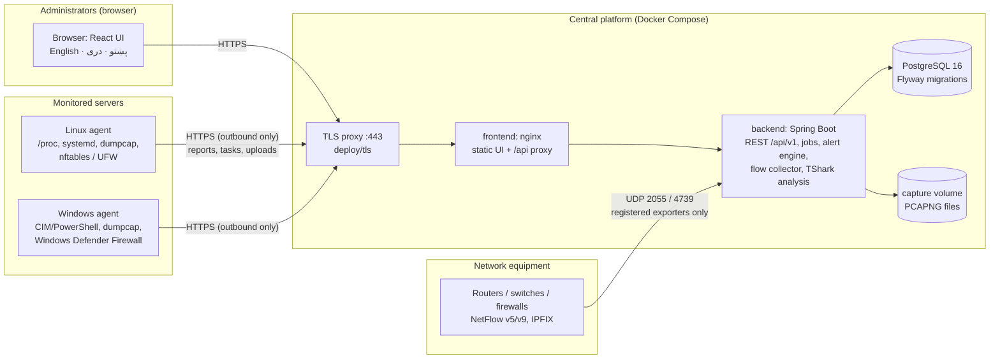
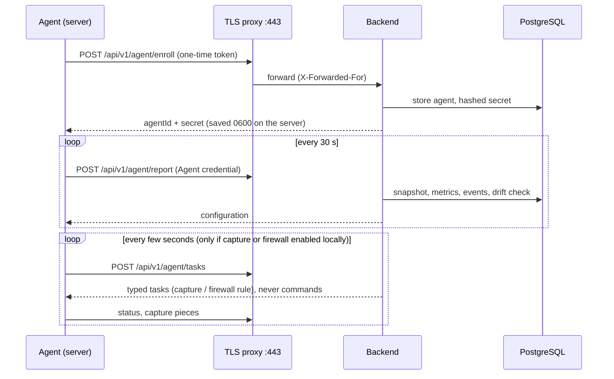
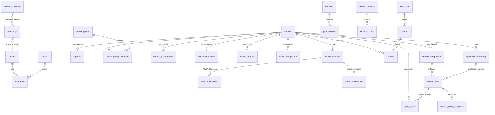

# Diagrams

The diagrams use Mermaid; GitHub and most Markdown viewers draw them.

## 1. Architecture

## 2. Network communication and ports

| From | To | Port | Purpose |
|---|---|---|---|
| Administrators' browsers | TLS proxy | TCP 443 | Web UI and API |
| Agents | TLS proxy | TCP 443 | Enrolment, reports, tasks, capture upload (outbound from servers) |
| Routers, switches, firewalls | Platform host | UDP 2055 (NetFlow), UDP 4739 (IPFIX) | Flow records, only if the collector is enabled; bind to the management network |
| TLS proxy | frontend container | TCP 8088 on 127.0.0.1 | Internal |
| Platform | — | — | The platform never connects to the servers; no inbound port is opened on monitored servers |

## 3. Database (main tables)

Not shown: `refresh_tokens`, `agent_enrollment_tokens`, `server_agent_configs`, `system_settings`.
Columns and constraints are in `backend/src/main/resources/db/migration/V1…V8`.
